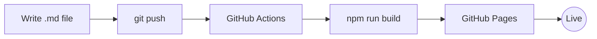
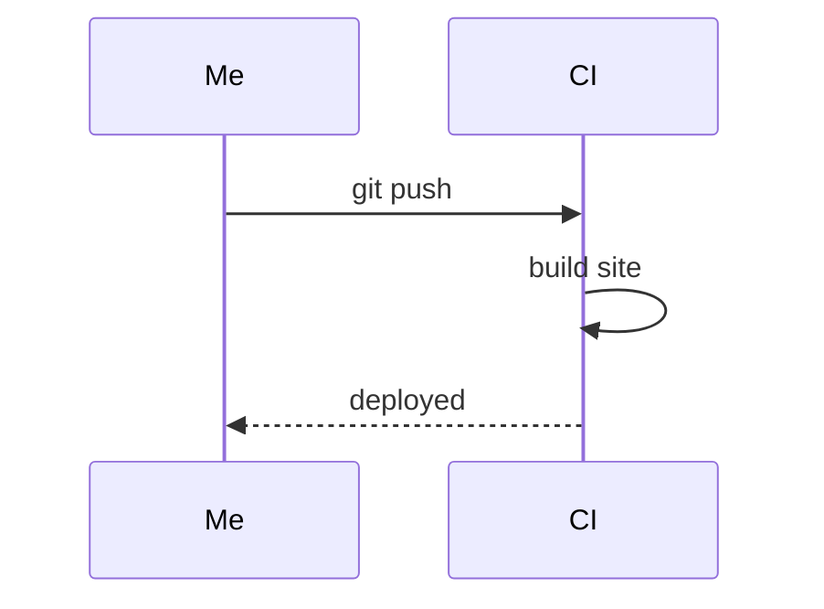

The old workflow for this site was: hand-edit HTML, maintain the post list by
hand, and copy-paste enough boilerplate to make a cathedral. The new workflow
is: write a markdown file, `git push`, and it's live.

## How publishing works now

A post is a single markdown file in `src/content/blog/`. The filename becomes
the URL. Frontmatter carries the metadata:

```yaml
---
title: 'This blog builds itself'
description: 'Shown on the blog index, RSS, and meta tags.'
pubDate: 2026-11-27
tags: ['meta', 'site']
draft: false        # true = hidden from production, still previewable locally
---

Your markdown here.
```

From there, GitHub Actions builds the site and ships it to GitHub Pages. The
whole pipeline looks like this:



To preview locally: `npm run dev`, edit, watch it reload. New posts scaffold
with `npm run new-post "My Title"`.

## Math

Equations are rendered at build time by KaTeX — no JavaScript runs on the page
for this, they're just typeset HTML:

$$
e^{i\pi} + 1 = 0
$$

Inline math works too: the closed form of the Fibonacci sequence is
$\frac{\varphi^n - \psi^n}{\varphi - \psi}$, where $\varphi = \frac{1+\sqrt5}{2}$
and $\psi = \frac{1-\sqrt5}{2}$.

And something with a bit more teeth:

$$
\int_{-\infty}^{\infty} e^{-x^2}\,dx = \sqrt{\pi}
$$

Use `$...$` for inline and `$$...$$` for display math. One rule to remember:
`$` opens math, so literal dollar signs in prose must be escaped with a
backslash — `\$5 and \$10` — or two of them will happily eat the words between
them as a bogus equation.

## Diagrams

Any [mermaid](https://mermaid.js.org/) diagram is a fenced code block:

````text

````

which renders as:


Flowcharts, sequence diagrams, gantt charts, state machines, mind maps —
anything mermaid supports.

## Graphs

Data charts are also just fenced blocks with a small JSON config. Shorthand
first — give it a type, labels, and a data array:

```chart
{
  "type": "bar",
  "label": "Coffees",
  "labels": ["Mon", "Tue", "Wed", "Thu", "Fri"],
  "data": [2, 4, 3, 5, 7]
}
```

Full [Chart.js](https://www.chartjs.org/) configs work too — multiple datasets,
colors, options, the works:

```chart
{
  "type": "line",
  "data": {
    "labels": ["2013", "2015", "2017", "2019", "2021", "2023", "2026"],
    "datasets": [
      {
        "label": "Vibes",
        "data": [40, 55, 52, 61, 58, 70, 82],
        "borderColor": "#00bf86",
        "backgroundColor": "rgba(0, 191, 134, 0.15)",
        "fill": true,
        "tension": 0.35
      },
      {
        "label": "Impostor syndrome",
        "data": [60, 58, 61, 55, 48, 40, 31],
        "borderColor": "#9e9a9a",
        "borderDash": [6, 4],
        "tension": 0.35
      }
    ]
  },
  "options": {
    "scales": { "y": { "beginAtZero": true } }
  }
}
```

A bad chart config fails the *build*, not the page — you find out in CI, not
from a broken post.

## Images, code, and the rest


Regular markdown images work; drop files in `public/` and reference them
from the root, like the photo above. Code blocks get syntax highlighting:

```javascript
const posts = fs
  .readdirSync('src/content/blog')
  .filter((f) => f.endsWith('.md'))
  .map((f) => render(parse(read(f))));
```

> Blockquotes, lists, tables — all the usual markdown furniture is here.
> The cow in the footer survived the migration too.

| Feature | Renders at | Client JS? |
| ------- | ---------- | ---------- |
| Math    | build time | none       |
| Mermaid | page load  | only if a diagram exists |
| Charts  | page load  | only if a chart exists   |
| Images  | build time | none       |

The diagram and chart libraries only download when a page actually contains
one, so a pure-prose post stays featherweight.

That's the system. Next post is just a markdown file and a push.
